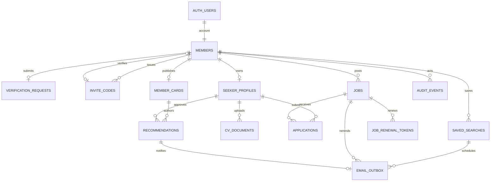
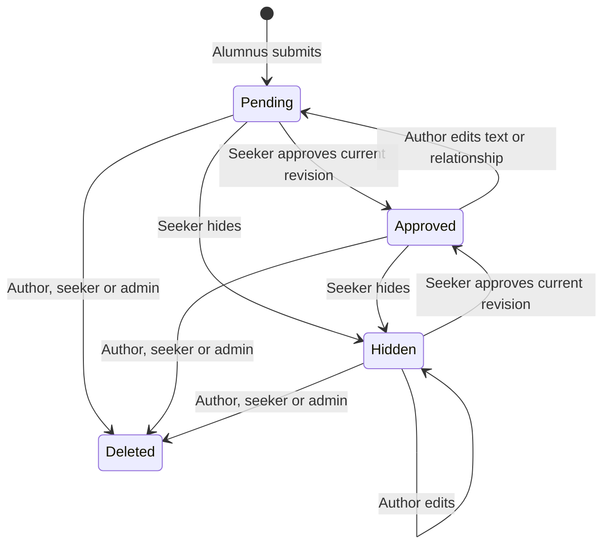

# Ofek 324: database and RLS review

This preserves the original **PostgreSQL design review**, shown before UI work.
The running Azure app now uses the equivalent full T-SQL model and native RLS in
[`azure/migrations/`](azure/migrations/). The Azure implementation uses opaque
server-validated sessions instead of Supabase JWTs, and private Azure Blob Storage
instead of Supabase Storage. See [README.md](README.md) for the current application,
deployment, verification and operations instructions. PostgreSQL-specific SQL and
grants below describe the preserved reference implementation, not the live SQL engine.

## Model



### Public API tables

| Table | Contents and constraints |
|---|---|
| `members` | Auth UUID, pending/approved/rejected/banned status, unit-member/external-recruiter kind, seeker/poster capabilities, admin flag, inviter and approval timestamp. No public email directory. |
| `verification_requests` | Name, unit service years, release date/already-released, LinkedIn, requested member kind. Visible only to applicant and admins. External recruiters supply no fictional military-service years. |
| `invite_codes` | Exactly five lifetime slots per approved unit member, SHA-256 token hashes, issuer, redeemer, issuance/revocation/redemption timestamps. Raw codes returned once when issued; hashes are not selectable by browser roles. |
| `jobs` | Title/company, city + onsite/remote/hybrid, job type, seniority, normalized tech tags, rich-text Markdown description, optional salary range/currency/period, apply method and destination, referral flag, open/closed state, timestamps, 60-day expiry, generated full-text index. |
| `seeker_profiles` | Name, headline, release information, experience, skills, preferred roles/locations, LinkedIn/GitHub, bio, looking/open/hidden visibility, active CV reference, admin moderation state. |
| `member_cards` | Separately published recommender account card: approved-form name and unit years, self-reported headline/current title/company, publication consent timestamp, and `/members/{id}` route. Does not expose a hidden seeker profile, release date, CV, or the full verification form. |
| `recommendations` | Author + seeker, text, optional relationship, pending/approved/hidden state, content revision, approved revision/date, review and creation/update dates. Unique per pair; self-recommendation prohibited. |
| `cv_documents` | Owner, generated object path, PDF filename, MIME, size capped at 5 MiB, explicit attestation time/version, pending/ready state, file hash, verification time. Composite foreign key prevents associating a profile with another member's CV. |
| `applications` | Job + applicant, timestamp, unique application per pair. Owner, applicant, and admin visibility only. Applicant can withdraw. |
| `saved_searches` | Structured job filters, explicit email opt-in, server-recorded consent time, last/next weekly digest. Accessible only to the owning verified seeker. |
| `audit_events` | Admin decisions, invite approvals, job deletion/renewal, profile moderation. No CV content or verification forms copied into audit entries. Admin read-only; clients cannot forge or erase events. |

### Backend-only tables

`private.email_outbox` holds recipients, job/search references, deduplication keys,
delivery states, attempts, leases, and provider IDs. `private.job_renewal_tokens`
holds only hashes of limited-lived renewal credentials, bound to a poster, job, and
specific expiry cycle. Neither table is exposed through browser grants.
New recommendation submissions now enqueue a deduplicated approval notification
transactionally. Actual email delivery, job/digest queueing, token
issuance/redemption, and scheduling have **not** been implemented yet.

`profile_cards` and `applicant_cards` are **security-invoker views**, not extra
tables. They respect the caller's RLS and attach approved, currently publishable
recommendation counts. Applicant cards leave profile details null and counts at
zero when a seeker hides their profile.

## Permission matrix

All thirteen application tables have RLS enabled. Database grants also protect
individual columns; UI checks are not the authorization boundary.

| Operation | Public / pending / rejected / banned | Approved seeker or alumni poster | Approved external recruiter | Admin |
|---|---|---|---|---|
| Read community jobs, profiles, counts | No | Yes, subject to visibility | Yes, subject to visibility | Yes |
| Read verification details | Own status/form only for signed-in accounts | Own only | Own only | All |
| Approve, reject, or ban | No | No | No | Valid transitions through guarded RPC |
| Post jobs | No | Yes | Yes | Yes |
| Edit/delete jobs | No | Own only | Own only | Any |
| Publish/update seeker profile | No | Own only | No | Own only; can moderate any |
| See a hidden profile/CV | No | Own only | No | Yes |
| Apply through site | No | Own visible profile, eligible open job | No | As an eligible seeker |
| Read applications | No | Applicant or job creator | Own jobs only | All |
| Issue invitation codes | No | Five lifetime slots | No | Five unit-member slots |
| Read raw CV bytes / create Storage signed URLs directly | No | No | No | No |
| Receive short-lived CV URL from authorized backend | No | Own/current visible CV | Current visible CV | Yes |
| Manage saved searches | No | Own only | No | Own only |
| Write a recommendation | No | Released alumni only, not for themselves | No | Only if an eligible alumnus |
| Approve/hide a recommendation | No | Recipient only, exact reviewed revision | No | No approval override |
| Edit recommendation text | No | Author only | No | Only own, if eligible |
| Delete a recommendation | No | Author or recipient | No | Any |
| See pending/hidden recommendations | No | Author or recipient | No | All |
| Read published author cards and approved recommendations | No | Yes, subject to visibility | Yes, subject to visibility | Yes |

The explicit external-recruiter exception is necessary to reconcile "unit members
only" with the requested recruiter role. Recruiters require **manual admin
approval**; an invite cannot qualify them or give them seeker/inviter privileges.

“Publicly on a profile” means visible **inside the verified community**. Nothing
about recommendations, their counts, or author cards is public to the internet.

## Important policy examples

The complete policies, grants, and guarded functions are in
`202611050002_access.sql`. For example:

```sql
create policy jobs_insert on public.jobs
  for insert to authenticated
  with check (private.can_post() and creator_id = auth.uid());

create policy jobs_update on public.jobs
  for update to authenticated
  using (private.is_admin() or (private.can_post() and creator_id = auth.uid()))
  with check (private.is_admin() or (private.can_post() and creator_id = auth.uid()));

create policy cvs_backend_only on storage.objects as restrictive
  for all to anon, authenticated
  using (bucket_id <> 'cvs') with check (bucket_id <> 'cvs');
```

Additional column-level grants prevent owners from rewriting `creator_id`,
`created_at`, or `expires_at`. Expiration is changed only by the owner/admin
renewal RPC. No authenticated client can update membership status, admin flags,
invite hashes, CV publication state, or profile moderation columns.

Permission helpers consult live membership rows and confirmed Auth identities,
not role claims copied into a JWT. A ban therefore removes access on subsequent
queries without waiting for token expiry. All security-definer functions pin an
empty search path, fully qualify application objects, and revoke default PUBLIC
execution.

The recommendation policies and grants are in `202611050004_recommendations.sql`.
For example:

```sql
create policy recommendations_insert on public.recommendations
  for insert to authenticated
  with check (
    author_id = auth.uid() and seeker_id <> auth.uid()
    and private.recommendation_is_publishable(author_id, seeker_id)
  );

create policy recommendations_read on public.recommendations
  for select to authenticated
  using (private.is_verified() and (
    author_id = auth.uid() or seeker_id = auth.uid() or private.is_admin()
    or (approval_status = 'approved'
      and private.recommendation_is_publishable(author_id, seeker_id))
  ));
```

Authors receive UPDATE grants on text and relationship only. Only the recipient's
guarded `review_recommendation` RPC can approve/hide a row. A database trigger
revokes approval whenever approved content changes, and the RPC requires the
exact revision the seeker reviewed.

## Approval and invitation decisions

- Every Auth signup starts pending, regardless of supplied user metadata.
- A confirmed email and a completed verification form are required for both
  approval paths. Anonymous Supabase Auth sign-ins are not eligible.
- Manual approval grants unit members both seeker and poster capabilities.
  External recruiters get poster capability only.
- An invitation is a verified member's **vouch**, not independent proof of
  service. Codes must be shared with known unit members.
- A redemption locks the applicant, invite, and inviter rows; marks the code
  used; records provenance; and approves the account in one transaction.
- Rotating an unused code invalidates its old value but never increases the five
  lifetime slots. Used and revoked slots cannot be refilled by members.
- Rejected/banned users cannot self-resubmit or redeem an invitation. Appeals and
  granting/revoking administrator status require an operator procedure for now.
- Administrative actions cannot ban another admin or demote the acting admin
  through the normal membership-review RPC.

## Job and profile behavior

- Jobs expire automatically in reads after 60 days; correctness does not depend
  on a scheduler marking them expired. Creators/admins still see expired jobs.
- Renewal sets expiry to 60 days from now; repeated renewals do not accumulate
  years. The email phase will schedule reminders seven days before expiration.
- Applications require a visible, unmoderated seeker profile, an active poster,
  an open unexpired job, and the `profile` apply method. Self-applications and
  duplicates are blocked in the database.
- Hidden profiles are visible only to their owners/admins, **including after an
  application**. A poster retains the application record but loses access to the
  hidden profile/CV. The UI must explain this privacy choice.
- Admin profile removal hides the existing row rather than allowing a
  delete/reinsert to bypass moderation.
- Rich text will be stored as Markdown from the editor, with raw HTML disabled
  by the future renderer. No raw HTML rendering is authorized by this schema.
- Search uses PostgreSQL `simple` full-text tokenization for Hebrew/English and
  normalized tag filters. It supports token search, not Hebrew morphological
  analysis or fuzzy/AI matching.
- The home release count includes only visible, unmoderated, approved profiles
  with a future release date within three calendar months.

## Recommendations and credibility cards

- **Alumnus eligibility:** an approved, email-confirmed unit member whose
  membership-verification form says already released or whose recorded release
  date has arrived. Serving soldiers can receive recommendations but cannot yet
  author them. Changing one's editable seeker-profile dates cannot grant this
  privilege. This is the interpretation of “verified alumnus” used here.
- An author first publishes a separate member card. Name and service years come
  from the approved/vouched membership form; headline/current title/company are
  self-reported, not employment-verified. Publication defaults to off.
- No verification data is mass-published by the migration. The explicit card
  publication action consents to displaying its name/service-year subset inside
  the community. The full form, email, planned release date, and CV remain private.
- An author does not need to be seeking a job. Their account link resolves to
  the planned `/members/{member_id}` page and never forces a hidden seeker profile
  into the directory. Hover/focus previews and tap/click details remain UI work.
- One recommendation per author/seeker pair. Content is plain text, 20–4,000
  characters; the optional general relationship label is at most 160 characters.
  The editor must show the same no-classified-information guidance as profiles.
- New recommendations start pending. Only the recipient can approve, hide,
  or reapprove them. Authors, recipients, and admins can delete them. Admins
  cannot rewrite another author's words or approve on the recipient's behalf.
- Editing approved text **or relationship** returns it to pending. A stale
  approval attempt fails rather than approving words the seeker did not read.
  Editing a hidden recommendation keeps it hidden; the author cannot undo that
  choice. A no-op edit does not revoke approval.
- Authors and recipients can manage their own pending/hidden records. Other
  members see only approved recommendations whose seeker is visible/unmoderated
  and whose author is still verified, eligible, and publishing a card.
- Hiding/moderating a seeker, banning either party, or withdrawing the author's
  card publication removes public display and badge contribution. Existing
  application records do not bypass hidden-profile rules.
- `recommendation_count` is derived rather than client-writable. The profile-card
  and applicant-card views share it; `search_profiles(p_has_recommendations =>
  true)` uses the same visibility-aware count. Admin stats include total rows,
  including pending/hidden ones, rather than misleadingly presenting them all
  as approved endorsements.
- A new submission creates one transactional email-outbox entry referencing the
  recommendation, with no text or service details copied into the queue. Edits
  do not generate notification spam. Approval/hiding cancels pending or failed
  notifications; deletion cascades to its queue entry. The eventual worker must
  recheck live status and eligibility before sending, including leased entries.



## CV access contract

`cvs` is a private Supabase bucket with a 5,242,880-byte limit and
`application/pdf` allowlist. MIME and extension checks alone do not prove a file
is a PDF, so direct browser Storage access is denied even for the owner/admin.

The future Next.js server endpoints must:

1. Authenticate using the caller's session; enforce request size before reading
   an unlimited request body.
2. Require the exact attestation checkbox and show the publication guide.
3. Validate actual PDF bytes/structure and reject invalid or oversized files.
4. Call `begin_cv_upload` as the caller, preserving RLS/ownership checks.
5. Upload validated bytes to the returned object path with the server-only
   service key, then call service-only `complete_cv_upload`.
6. For download, read `cv_documents` with the caller's session first. Only after
   that RLS-authorized lookup may the backend sign the exact returned path for
   **60 seconds**. It must not accept an unchecked object path from the browser.
7. Return private/no-store responses and avoid logging CV data or signed URLs.
8. Delete failed, abandoned, and replaced objects through the Storage API, then
   remove the corresponding unreferenced metadata. `discard_cv_upload` permits
   removal of an owned pending row only after its stored object is gone.

Supabase Storage clients can otherwise request their own signed-URL lifetimes,
which is why granting everyone SELECT on `storage.objects` would not satisfy
the short-lived-URL requirement. A previously issued URL can still work for its
remaining 60-second lifetime after a ban/hide; a signed URL is a bearer credential,
not instantaneous revocation.

No PDF-validation endpoint or URL signer is implemented at this review checkpoint.
The database establishes the boundary; the service key must never be exposed.

### Planned Hebrew attestation and publication guide

> קורות החיים שלי אינם מכילים מידע מסווג או מידע שלא אושר לפרסום.

> בתיאור השירות יש להתמקד בכישורים, בתחומי אחריות ובניסיון מקצועי במונחים
> כלליים. אין לציין מערכות, פרויקטים, מבצעים, נתונים או פרטים שלא אושרו
> לפרסום. במקרה של ספק, יש להסיר את המידע ולברר מה מותר לפרסם עם הגורם
> המוסמך. סימון התיבה אינו מחליף אישור לפרסום.

Do not request clearance documents, classified records, service IDs, or military
technical details as verification evidence. No real military or personal data
is used in the fixtures.

## Email contract for the later implementation

The provider-specific points below describe the original Supabase/Resend option.
The Azure-only alternative would need its own authentication mail integration and
an Azure Communication Services sender/worker. Neither email path is implemented;
the consent, deduplication, privacy, and renewal requirements apply to both.

- Configure Resend SMTP for real Supabase magic links. Supabase's default SMTP
  is restricted to project-team addresses and currently two messages/hour.
- Use a verified sending domain already owned by the operator. Gmail ownership
  does not permit sending through Resend as `@gmail.com`; acquiring a domain
  would not be free.
- Schedule reminders for the job's current expiry cycle, seven days before
  expiration, and weekly digests for explicitly opted-in searches.
- Send a transactional approval-request email for each new recommendation,
  linking to received recommendations behind sign-in. Send no recommendation text,
  military relationship, CV, or service years in that email. New-recommendation
  queueing exists; the sender and delivery configuration do not yet.
- Use unique dedupe keys, worker leases, bounded retries, and Resend idempotency
  keys. Recheck account eligibility, live job status, and consent at send time.
- Deliver matching new jobs since the last successful digest; provide visible
  unsubscribe plus appropriate list-unsubscribe headers. Do not email CVs or
  serving-member lists.
- Issue single-use, short-lived, hashed renewal credentials bound to the poster
  and expiry cycle. Do not mutate a job on GET: mail-security scanners follow
  links. The eventual action must use an intentional POST and reject stale,
  replayed, expired, or banned-poster tokens.
- Keep authentication and digest traffic within the shared email allowance;
  prioritize login email, queue bounded digest batches, and keep overages off.
- Do not use frequent fake activity just to defeat free-project pausing.

These are implementation requirements, not claims that emails or cron jobs work yet.

## Azure infrastructure and budget findings

Read-only Azure access was verified on 5 November 2026 for `OSALZBERG@GMAIL.COM`.
The available personal subscription is **Visual Studio Enterprise Subscription**
(`5edb3519-a630-43b6-82ac-cf92b84ec378`). Its reported offer is `MSDN_2014-09-01`
and its spending limit is `CurrentPeriodOff`. No subscription settings were changed.

After the user authorized starting free tiers, the following were provisioned:

- Resource group: `rg-ofek-jobs-dev`, West Europe.
- App Service plan: `asp-ofek-jobs-free`, verified by the plan API as
  **F1 / Free**, family F, capacity 1.
- Web app: `ofek324-osalzberg-dev`, Node.js 24 LTS, HTTPS required,
  TLS 1.2 minimum, FTP disabled, Always On off.
- Host: https://ofek324-osalzberg-dev.azurewebsites.net. It returns HTTP 200 with
  Azure's placeholder, not a finished application.

The user subsequently authorized an Azure-only test at $5-15/month. The group now
also contains:

- SQL logical server `sql-ofek324-osalzberg-fc`, France Central, with Entra-only
  authentication explicitly bound to the personal tenant. West Europe SQL
  provisioning was unavailable for this subscription.
- Database `ofek-jobs-poc`: Basic, 5 DTU, 2 GB maximum, local backup redundancy,
  no zone redundancy, encryption at rest enabled, paid threat detection disabled.
- Storage account `stofek324osalzbergdev`: Standard LRS / Hot in West Europe,
  private `cvs` container, HTTPS required, public blob access and shared-key
  authorization disabled.

The SQL firewall allows one operator IP only, not all Azure services or the
internet. This is not yet a web-app database connection. All cloud fixtures are
synthetic, and the test PDFs were removed after verification.

**This subscription's credit benefit is for individual development/testing, not
production.** Do not launch the live alumni community on that benefit. An eligible
production subscription is needed before a real launch; it may still host selected
Free SKUs, but a paid-capable account is not a guarantee of zero charges.

### Light-use monthly estimate

Retail SQL and Blob rates were retrieved from the Azure Retail Prices API on
5 November 2026. Email is an illustrative estimate from Microsoft's email-pricing
documentation, not an enabled service or a promise of future pricing.

| Component | Assumption | Estimated USD |
|---|---|---|
| Existing web host | App Service F1, within its quotas | 0.000 |
| SQL Basic, France Central | 31 days x $0.201/day | 6.231 |
| Private Blob Storage | 5 GB x $0.0196/GB-month | 0.098 |
| Blob operations | 10,000 writes + 100,000 reads | 0.097 |
| Illustrative Azure email | 1,000 recipients + 100 MB total | 0.262 |
| Network/other allowance | Planning allowance, not a quoted network tariff | 1.000 |
| Total | Light-use example, not measured billing | **7.688** |

Use **roughly $7-10/month before tax** as the small-pilot estimate, not a $15 hard
cap. SQL billing continues while the database exists, even when idle. Metered
traffic, extra retention, larger workloads, hosting upgrades, or paid identity/
scheduling choices can change the total. No budget alert or hard spending cap
has been configured; no subscription-wide spending setting was changed.

F1 remains a shared development host with quotas and sleep, not an always-on
worker or production SLA. No paid web-host upgrade, registry, monitoring
workspace, custom domain, email service, or scheduler has been created.
Authentication and scheduling choices require their own validation before launch.

Azure PostgreSQL B1ms plus minimum storage was estimated at approximately
$18.91/month in West Europe before other services, so it was not provisioned.
SQL Basic fits the tested budget, but it is **not PostgreSQL-compatible**: the
full tables, functions, search, recommendations, invites, CV workflow, and
authorization rules must be ported and reviewed before UI implementation.
Supabase/Resend remain an unprovisioned alternative, not a dependency of the Azure
proof. No third-party sign-in is needed to rerun that proof.

### Verified first-party references

- [Azure Node.js quickstart](https://learn.microsoft.com/azure/app-service/quickstart-nodejs):
  portal/VS Code paths offer F1; its CLI example uses a **paid Premium tier** and
  must not be copied unchanged.
- [Azure App Service limits](https://learn.microsoft.com/azure/azure-resource-manager/management/azure-subscription-service-limits#azure-app-service-limits).
- [Visual Studio Azure benefit restrictions](https://learn.microsoft.com/visualstudio/subscriptions/faq/subscriber/azure/#can-i-use-my-monthly-azure-credits-to-run-production-applications).
- [Supabase pricing](https://supabase.com/pricing).
- [Supabase custom SMTP requirements](https://supabase.com/docs/guides/auth/auth-smtp).
- [Resend pricing](https://resend.com/pricing).
- [Azure Retail Prices API](https://prices.azure.com/api/retail/prices).
- [Retail Prices API documentation](https://learn.microsoft.com/en-us/rest/api/cost-management/retail-prices/azure-retail-prices).
- [Azure email pricing](https://learn.microsoft.com/en-us/azure/communication-services/concepts/email-pricing).

## Current validation boundary

The automated checks execute the actual migrations and PostgreSQL RLS logic under
anonymous, authenticated, and service roles against synthetic fixtures. They cover
approval, invitation replay/rotation/revocation, privilege escalation, ownership,
expiration, application isolation, hidden profiles, bans, CV grants/limits,
filtering, consent, and administrative statistics.
Recommendation checks additionally cover alumni eligibility, author-card consent,
one-per-pair/no-self rules, recipient-only revision-safe approval, hidden-state
preservation, edit/delete permissions, privacy-safe badges/search, notification
deduplication/cancellation, and security-invoker discovery views.

The original PostgreSQL suite has **66 passing tests**. Separately, the live Azure
proof has **16 passing authorization checks** against Azure SQL Basic. It also
verified that an actual private synthetic PDF is not anonymously readable, a
read-only user-delegation SAS returns the correct bytes, writes fail, and reads
fail after its actual 60-second maximum lifetime.

These do **not** establish working Google OAuth, magic-link delivery, application
PDF validation/5 MB enforcement, authorization of a real user's CV download
endpoint, concurrent hosted-application behavior, the email worker, load
performance, browser UX, or a full Azure schema/application deployment. The Blob
test used the operator's Azure identity, not a job-board login. The Azure SQL
tests cover a synthetic job subset, not profiles, invites, or recommendations.
